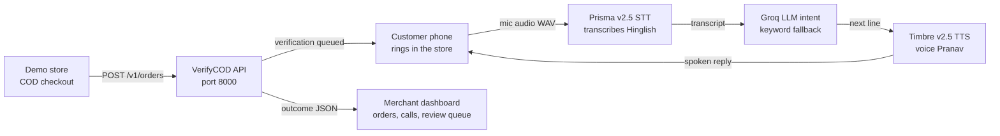

# VerifyCOD

**VerifyCOD calls every Cash-on-Delivery buyer in their own language and confirms the order before you ship it. Fewer returns, more money kept, no manual calling.**

Built on Gnani **Prisma v2.5** (speech-to-text) and **Timbre v2.5** (text-to-speech). Built for the Gnani.ai Great Indian AI Internship Challenge.

## The problem

COD orders in India get returned ~20–30% of the time — the buyer never ordered, changed their mind, or the address is wrong. The seller pays shipping both ways and waits a week for stock to come back.

VerifyCOD phones the buyer, confirms the order in Hinglish, fixes the address if it's wrong, and tells the seller what happened — before anything ships.

## How it works



Two servers, both local. No real phone calls — the "call" is a simulated customer phone inside the demo store, a real-time voice loop in the browser. Real telephony (Exotel/Twilio) slots in later without changing the voice loop; Telegram bots can't do live voice calls, which is why the phone widget is the stand-in.

## The call

Three turns by design — availability, address, thank-you — in Hinglish throughout:

1. **Seller posts an order** — `POST /v1/orders` with customer, address, items, amount, `payment_mode=COD`. Idempotent on `external_order_id`. The API stores it in SQLite and creates a verification (`ver_xxxx`). After 3 seconds the verification flips to `calling` and the phone widget rings.
2. **The voice loop** — you answer on the phone widget and just speak. The mic audio is encoded as WAV in the browser (Gnani STT takes WAV, not webm). Prisma transcribes it; a Groq LLM (`gpt-oss-20b`) classifies what you meant — Devanagari, Roman Hinglish, multi-intent lines ("haan, available hoon, address bhi sahi hai") — with the keyword matcher as fallback. A state machine picks the next agent line and Timbre speaks it back.
3. **Always listening, with barge-in** — there is no button to tap. A volume monitor detects when you start speaking, records until 1.5s of silence, sends the clip, and goes back to listening when the agent finishes. Speak while the agent is still talking and the audio stops mid-sentence. Guardrails are hardcoded: never asks for OTP/PIN, discloses it is automated, ends politely on anger or human requests.
4. **The outcome** — the transcript becomes a strict JSON outcome (Pydantic): `CONFIRMED`, `ADDRESS_UPDATED`, `CANCELLED_BY_CUSTOMER`, `RESCHEDULED`, `WRONG_PERSON`, `CALLBACK_REQUESTED`, or `NEEDS_REVIEW`, with confidence, corrected address (pincode by regex, landmark from "near …"), and the full transcript. Stored in SQLite, shown on the dashboard and on the store order page.

## Try it — five call flows

Place an order in the demo store, answer the phone when it rings, and say:

| Say | Outcome |
| --- | --- |
| "haan, sahi hai" all the way | `CONFIRMED`, confidence ~0.95 |
| "address badlo", then a new address with pincode | `ADDRESS_UPDATED`, pincode + landmark parsed |
| "nahi chahiye" | `CANCELLED_BY_CUSTOMER` |
| "kal bhej do" | `RESCHEDULED` |
| "main Ramesh nahi" | `WRONG_PERSON` |
| "baad mein call karo" | `CALLBACK_REQUESTED` |

## The product

Open http://127.0.0.1:8000 — a full website, not just a dashboard:

- **Landing page** (`/`) — hero with a live animated demo call, the RTO math, how it works, features, pricing, FAQ, and sign-up / sign-in. "Try the live demo" drops you into a seeded dashboard with 6 realistic orders — no account needed.
- **Sign-up / sign-in** — create a merchant account (name, store, email, password ≥ 8 chars, hashed with PBKDF2). Each account gets its own merchant, its own data, and ₹100 starting credits. Sessions last 48h. Merchants can never see each other's data (cross-merchant access returns 404).
- **Dashboard** (`/dashboard`) — 12 pages, plain HTML + vanilla JS, hash-routed SPA: KPIs and charts, orders (filters, search, bulk retry/cancel, CSV export, row drawer with timeline and transcript), conversations (waveform player, per-turn audio, extracted JSON, Mark correct / Flag as wrong), review queue, analytics, integrations (CSV import wizard, Shopify / Sheets / WooCommerce), API keys, webhooks (HMAC signing, delivery log, test + replay), billing, settings, team roles (Owner / Admin / Ops / Developer / Viewer), and Cmd+K search. Test/Live toggle in the top bar.
- **Demo store** (port 8001) — a storefront with cart, COD checkout, and the customer-phone widget. Buy a Kurta, place the COD order, answer the phone.

**API keys:** send your merchant key as an `X-API-Key` header and the order is filed under your merchant. Without a key it goes to the demo merchant. The demo store ships with a public demo key (order-creation only) so its orders land in the demo dashboard. Cost is ₹2 + ₹0.50/min per call, deducted from credits automatically. Every call is recorded: turn-by-turn WAVs + one merged `recording.wav` per call, stored under `verifycod/recordings/` (gitignored).

## Quickstart

```bash
# 1. Get keys: app.gnani.ai -> API Keys, console.groq.com -> API Keys (free tier)
cp .env.example .env   # paste both keys in .env — never commit it
pip install -r requirements.txt

# 2. Check the voice path works
python test_api.py     # TTS writes test_reply.wav — play it; then test STT with a sample.wav

# 3. Run both servers (two terminals, from the project root)
cd verifycod && uvicorn app:app --reload --port 8000
cd store && uvicorn app:app --reload --port 8001
```

Open http://127.0.0.1:8001 — add the Kurta to the cart, place the COD order, answer the phone when it rings, and just speak. Interrupt the agent mid-sentence to test barge-in.

## Project structure

```
gnani-voice-buddy/
  README.md, requirements.txt, .env.example, test_api.py
  verifycod/          Server 1 — the API (port 8000)
    app.py            FastAPI + SQLAlchemy, /v1/orders, /v1/verifications, /api/voice
    dialog.py         state machine + intent matching + outcome extraction
    llm.py            Groq LLM intent classification (gpt-oss-20b), keyword fallback
    db.py             SQLAlchemy ORM models (SQLite now, Postgres via DATABASE_URL)
    static/landing.html     landing page + sign-up/sign-in (served at /)
    static/dashboard.html   merchant dashboard (12 pages, vanilla JS SPA)
    recordings/           per-call WAVs (gitignored, created on first call)
    verifycod.db      created on first run (gitignored)
  store/              Server 2 — the demo store (port 8001)
    app.py            serves the storefront
    static/index.html storefront + cart + COD checkout + customer phone widget
  app.py, static/     OLD single-page demo — superseded, kept for reference
```

## Tech stack

- **Backend:** FastAPI (Python), SQLAlchemy ORM (SQLite now, Postgres via `DATABASE_URL`)
- **STT:** Gnani Prisma v2.5 — `gnani-vachana` SDK 0.9.0
- **TTS:** Gnani Timbre v2.5 — same SDK, voice Pranav, language hi-IN
- **Frontend:** plain HTML + vanilla JS, mic encoded as WAV in the browser
- **Dialog:** Python state machine + Groq LLM intent (gpt-oss-20b, JSON mode) with keyword fallback
- **Outcome:** Pydantic strict JSON

## What's next

Real telephony (Exotel/Twilio), Postgres, Shopify adapter, risk scoring model. The API shape (`POST /v1/orders`, webhooks, outcomes) is designed so those slot in without changing the voice loop.
